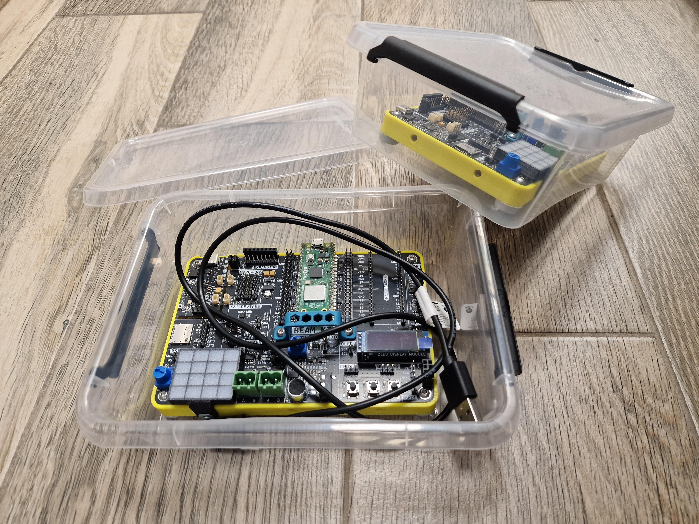
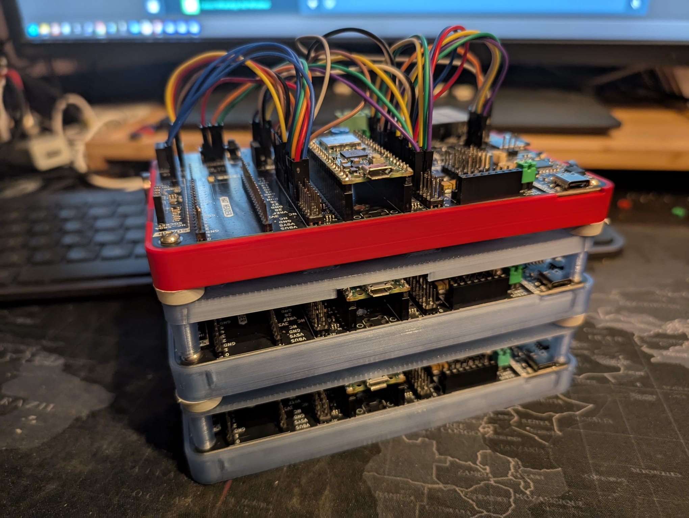
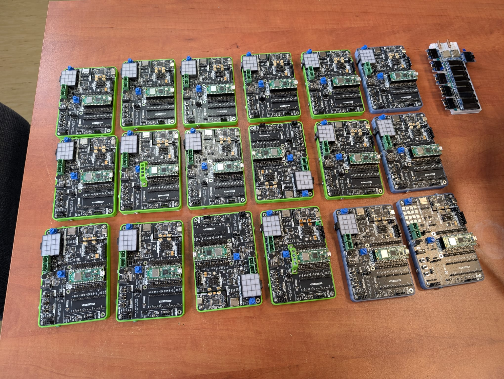
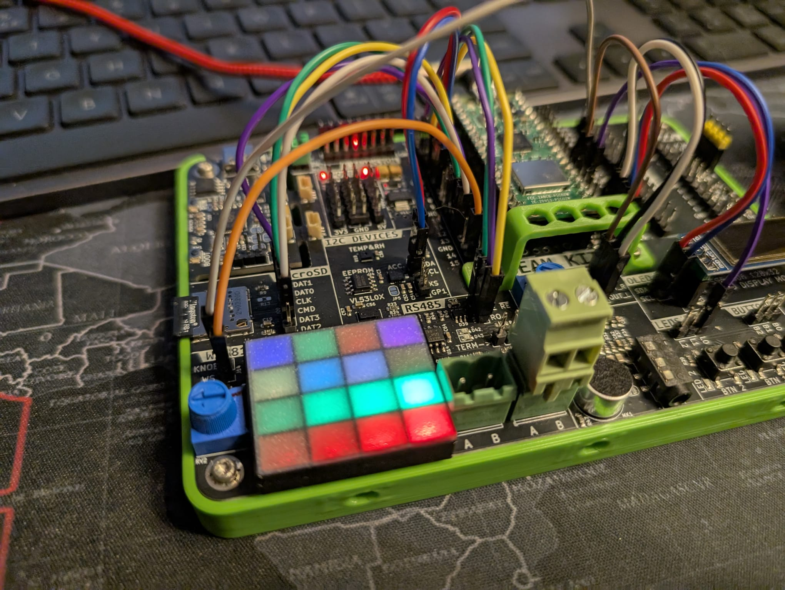
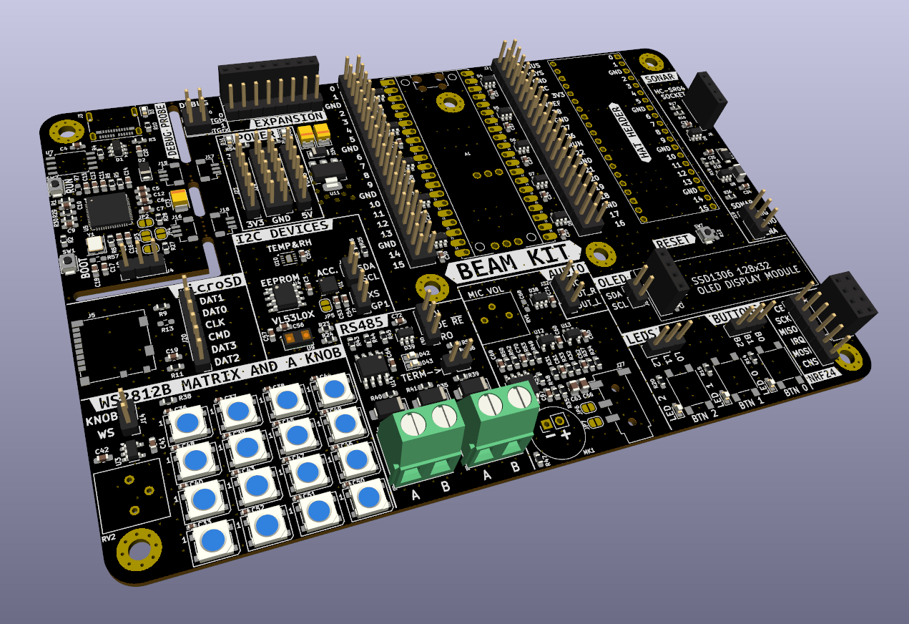
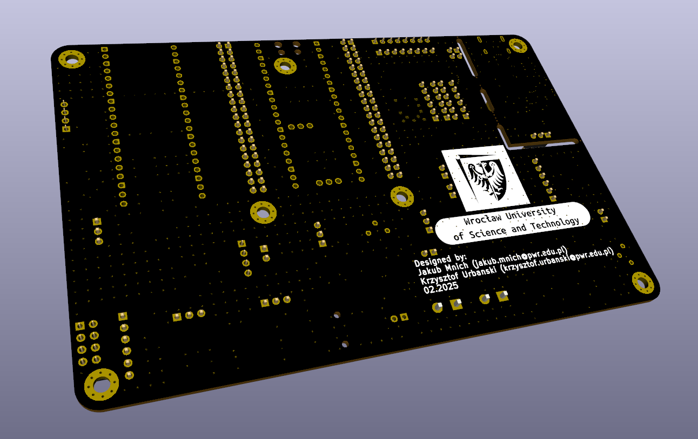

# Beam Kit 1

Open Source educational eval kit built around Raspberry Pi Pico. Designed for Raspberry Pi Pico 2W.

## 🚀 Features
- Socket for RPI Pico module
- Integrated debug probe with separate USB C socket, allowing for powering, programming and debugging the kit with a single cable
- I2C sensors, EEPROM and laser range finder
- Micro SD slot
- 4x4 WS2812 LED matrix
- industrial RS485 interface
- basic audio: analog microphone and stereo minijack output
- HAT socket
- SSD1306 OLED display
- NRF24 socket
- LEDs, knob and buttons

